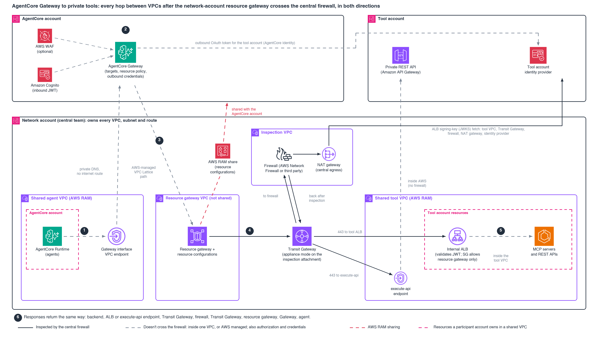

# Amazon Bedrock AgentCore Gateway to private APIs in a hub-and-spoke network with centralized inspection

Companion repository for the AWS blog post *Connect Amazon Bedrock AgentCore Gateway to private APIs in a hub-and-spoke network with centralized inspection*.

The post describes a pattern for enterprises where a central network team owns every VPC and subnet and every flow between VPCs must pass a central firewall. A network account owns the Amazon VPC Lattice resource gateway, routes it through AWS Transit Gateway and the inspection VPC, and shares one resource configuration per backend with the AgentCore account through AWS Resource Access Manager (AWS RAM). Requests and replies between AgentCore Gateway and your private APIs and MCP servers both cross the firewall, and application accounts never manage VPCs, subnets, or routes.

This repository contains the lab we used to test the pattern, the raw test output, and reference material that the post links to.

## Disclaimer

This is **sample code for demonstration and educational purposes only. It is not intended for production use without additional review, hardening, and security testing.** The lab illustrates the architecture pattern described in the accompanying blog post. Before you deploy any of it, you are responsible for evaluating it against your own security, compliance, and operational requirements, performing appropriate testing, and adapting it to your environment. Replace all placeholder values (account IDs, ARNs, endpoint IDs, subnet and security group IDs, DNS names) with your own.

## What this sample covers (and what it doesn't)

**Covered:**

- AWS CloudFormation templates for a network account, an AgentCore account, and a tool account that implement the pattern, including the firewall rules, endpoint policies, ALB `jwt-validation` rules, and a private REST API with an authorizer
- Scripts that create the Gateway and its targets, run every validation check from the post, and tear the lab down
- Raw output of the last full lab run, and reference material that the post links to

**Not covered (your responsibility before production):**

- Hardening. The security groups, firewall rules, and AWS WAF rules are starting points, not a production baseline. The deployment profiles are administrator profiles in dedicated lab accounts (see [Deployment permissions](#deployment-permissions)).
- Your own firewall. The lab uses AWS Network Firewall; we didn't test third-party firewalls or source NAT.
- Regions other than us-east-1, multi-Region designs, and private identity providers.
- Production change management, monitoring and alerting, cost controls, and an independent security review.

## Repository structure

```text
.
├── README.md
├── docs/                           reference material linked from the blog post
├── lab-code/
│   ├── 01-hub-network.yaml         network account
│   ├── 02-spoke2-api.yaml          tool account: private REST API
│   ├── 03-spoke1-inbound.yaml      AgentCore account: Cognito, AWS WAF, Gateway role
│   ├── 04-spoke2-alb-backend.yaml  tool account: internal ALB and backend
│   ├── 05-spoke1-agent-probe.yaml  AgentCore account: probe Lambda function
│   ├── 06-spoke1-runtime.yaml      AgentCore account: optional Runtime
│   ├── run-lab.sh, lib.sh, observability.sh, x3-jwks-egress.sh, x8-rate-limit.sh
│   ├── extra_tests.py, tools_targets.py, runtime_test.py, runtime_agent/
│   └── gateway-resource-policy.example.json
├── evidence/                       raw output of the last lab run
├── media/                          Figure 1 and the script that draws it
├── CODE_OF_CONDUCT.md
├── CONTRIBUTING.md
└── LICENSE
```

## Reference material

| Document | Contents |
|---|---|
| [docs/lab-layout.md](docs/lab-layout.md) | Address plan, route tables, Availability Zones, resource gateway sizing and permanent settings |
| [docs/build-order.md](docs/build-order.md) | Build steps for each account, and the values teams pass to each other |
| [docs/validation-checks.md](docs/validation-checks.md) | All 14 validation checks, with expected and observed results |
| [docs/test-results.md](docs/test-results.md) | Results of the last lab run, mapped to commands and evidence files |
| [docs/troubleshooting.md](docs/troubleshooting.md) | Symptoms, causes, and the log that shows each |
| [docs/logging.md](docs/logging.md) | One log source per hop, and the account that owns it |
| [docs/quotas.md](docs/quotas.md) | Quotas that shape the design |
| [docs/considerations.md](docs/considerations.md) | Firewall rule-order semantics, AWS WAF rule groups, private CA details, alternatives considered, other considerations, security checklist |

## The lab

The lab uses three member accounts in one AWS Organizations organization, plus the management account for the SCP test.

| Role | Owns |
|---|---|
| Network (hub) | VPCs, subnets, transit gateway, AWS Network Firewall, NAT gateway, VPC Lattice resource gateway and resource configurations, the Gateway and `execute-api` interface endpoints and their policies, AWS RAM shares |
| AgentCore | Gateway, targets, credential providers, Amazon Cognito user pool for inbound tokens, AWS WAF web ACL, CA secret, probe Lambda function, optional AgentCore Runtime |
| Tool | Private REST API with a Cognito authorizer, internal Application Load Balancer (ALB) with JWT validation and a Lambda backend (REST and MCP), tool Cognito user pool, ALB certificate |



### Files in `lab-code/`

| File | Deploys or does |
|---|---|
| `01-hub-network.yaml` | Network account: everything in the first row above, including the firewall rules and endpoint policies |
| `02-spoke2-api.yaml` | Tool account: private REST API with a Cognito user pool authorizer (also deployed in a second account to show that a new API needs no network change) |
| `03-spoke1-inbound.yaml` | AgentCore account: Cognito, AWS WAF web ACL, Gateway execution role |
| `04-spoke2-alb-backend.yaml` | Tool account: internal ALB with `jwt-validation` on every rule, Lambda backend, tool Cognito |
| `05-spoke1-agent-probe.yaml` | AgentCore account: a VPC Lambda function in the shared agent subnets that stands in for an agent |
| `06-spoke1-runtime.yaml` | AgentCore account: security group and role for an AgentCore Runtime in VPC mode |
| `run-lab.sh` | Deploys, tests, and tears down the lab |
| `observability.sh` | Turns on every log source, generates traffic, verifies what was logged, and tests the Gateway resource policy |
| `extra_tests.py` | Private CA, ALB token rejects, least-privilege IAM, and new tools without a new target |
| `x3-jwks-egress.sh`, `x8-rate-limit.sh` | Blocked egress for the ALB's signing-key fetch; AWS WAF rate-based rule |
| `runtime_test.py`, `runtime_agent/` | Creates and invokes a VPC-mode AgentCore Runtime that calls the Gateway |
| `tools_targets.py` | Creates the OpenAPI and MCP server targets for the internal ALB |
| `gateway-resource-policy.example.json` | The Gateway resource policy from the post |
| `lib.sh` | Shared settings and helpers |

## Prerequisites

- An AWS Organizations organization with resource sharing enabled in AWS RAM from the management account (`aws ram enable-sharing-with-aws-organization`). Wait a few minutes before the first deploy; a deploy right after enabling it fails on the subnet share.
- Three dedicated, non-production member accounts and an AWS CLI profile for each: `lab-hub` (network), `lab-spoke1` (AgentCore), and `lab-spoke2` (tool). See [Deployment permissions](#deployment-permissions) for what each profile needs. For member accounts created with AWS Organizations, use `role_arn = arn:aws:iam::<account-id>:role/OrganizationAccountAccessRole`. The SCP test (`prove-sharee-scp`) also needs a management account profile.
- AWS CLI 2.37.7 or later, Python 3 (the scripts create `lab-code/.venv` with Boto3 1.43.106 or later), `curl`, and OpenSSL 1.1.1 or later.
- Capacity for 4 VPCs in the network account (the default quota is 5 per Region, including the default VPC).
- **Region: us-east-1 only as shipped.** `01-hub-network.yaml` uses the Availability Zone IDs `use1-az1`, `use1-az2`, and `use1-az4`, and `observability.sh` grants the us-east-1 Elastic Load Balancing log-delivery account. Other Regions need those edited.

Settings come from environment variables; defaults are in parentheses.

| Variable | Meaning |
|---|---|
| `AWS_REGION` (`us-east-1`) | Region |
| `HUB_PROFILE` (`lab-hub`), `S1_PROFILE` (`lab-spoke1`), `S2_PROFILE` (`lab-spoke2`) | AWS CLI profiles for the network, AgentCore, and tool accounts |
| `MGMT_PROFILE` (`lab-mgmt`) | AWS CLI profile for the management account, used only by `prove-sharee-scp` |
| `LAB_PY` (`lab-code/.venv/bin/python`) | Python with Boto3 1.43.106 or later |

## Deployment permissions

The scripts deploy and then delete whole account footprints, including IAM roles, so we ran them with the `OrganizationAccountAccessRole` (administrator) in dedicated lab accounts that hold nothing else. Don't run them in an account with other workloads. If you need a narrower deployment role, it needs the following, scoped to resources named `lab-*` where the service supports it:

| Profile | Services the scripts call |
|---|---|
| `lab-hub` (network) | AWS CloudFormation; Amazon EC2 (VPCs, subnets, routes, transit gateway, NAT gateway, VPC endpoints, security groups, flow logs); AWS Network Firewall; Amazon VPC Lattice (resource gateways, resource configurations, access log subscriptions); AWS RAM (shares and permissions); IAM (`iam:CreateRole`, `iam:PutRolePolicy`, `iam:PassRole` for flow-log delivery); Amazon CloudWatch Logs |
| `lab-spoke1` (AgentCore) | AWS CloudFormation; Amazon Bedrock AgentCore (gateways, targets, credential providers, runtimes); Amazon Cognito; AWS WAF; AWS Lambda; AWS Secrets Manager; Amazon VPC Lattice (`GetResourceConfiguration`, service network resource associations, `AssociateViaAWSService`); IAM (create, pass, and delete the `lab-*` roles); Amazon CloudWatch Logs; Amazon S3 (code bucket for the optional Runtime) |
| `lab-spoke2` (tool) | AWS CloudFormation; Amazon API Gateway; Elastic Load Balancing; AWS Lambda; Amazon Cognito; AWS Certificate Manager; Amazon S3 (ALB log bucket); IAM (the `lab-*` roles); Amazon CloudWatch Logs |
| Management account (`prove-sharee-scp` only) | AWS Organizations: `CreatePolicy`, `AttachPolicy`, `DetachPolicy`, `DeletePolicy` |

The permissions the pattern itself needs at run time are smaller and are scoped in the templates: the role that creates Gateway targets needs only the actions in the blog post's prerequisites (`extra_tests.py least-priv` verifies them), and the Gateway execution role in `03-spoke1-inbound.yaml` is limited to the lab's own workload identities, credential providers, and secrets.

## Run the lab

```bash
cd lab-code
./run-lab.sh deploy                # network, API, and AgentCore stacks; Gateway and first target (15–20 minutes)
./run-lab.sh test                  # inbound auth, private API path, AWS WAF
./run-lab.sh alb                   # internal ALB, OAuth, private CA, MCP and OpenAPI targets, probe Lambda
./run-lab.sh test-alb
./run-lab.sh negative              # managed mode on a shared subnet fails
./run-lab.sh evidence              # resource and association inventory
./run-lab.sh prove-multi           # second API through the same resource configuration
./run-lab.sh prove-return          # replies dropped at the firewall, then restored
./run-lab.sh prove-vpce-policy     # Gateway interface endpoint policy refuses an unlisted Gateway
./run-lab.sh prove-ram-permission  # shows why a customer managed AWS RAM permission can't replace the AWS managed one
./run-lab.sh prove-sharee-scp      # SCP keeps the Gateway the only consumer of the shared resource configuration
./observability.sh enable          # needs: alb
./observability.sh traffic         # then wait about 10 minutes
./observability.sh verify
./observability.sh policy-test     # Gateway resource policy on aws:SourceVpce; removed afterwards
./run-lab.sh extra-tools           # optional: new route and MCP tool behind the ALB
.venv/bin/python extra_tests.py pkix | alb-rejects | least-priv | spec-sync
./x3-jwks-egress.sh                # optional: removes and restores the ALB's signing-key egress rule
./run-lab.sh runtime && ./run-lab.sh test-runtime   # optional: AgentCore Runtime as the caller
./x8-rate-limit.sh                 # optional: run only from a machine whose IP you can afford to have blocked for a few minutes
./run-lab.sh teardown
```

The `prove-*` and test scripts restore any firewall rule, policy, or share they change, including on failure. `.lab-state.env` (resource IDs, no secrets) and `.pki/` (the lab's private CA and server key) are created in `lab-code/` and are ignored by git; `teardown` removes `.pki/`.

## Cost and clean up

AWS Network Firewall, the transit gateway attachments, the NAT gateway, the interface endpoints, the VPC Lattice resources, and the internal ALB bill by the hour while the lab exists. VPC Lattice also bills each service network resource association by the hour; in our runs, each Gateway target had its own association. Tear the lab down when you finish:

```bash
cd lab-code && ./run-lab.sh teardown
```

- `teardown` deletes the hourly-billed resources first. If the network stack doesn't finish deleting, the shared agent subnets still hold network interfaces: AgentCore Runtime network interfaces can remain for up to 8 hours after the Runtime is deleted. Run `teardown` again later.
- `teardown` deletes the ALB log bucket, the CA secret, and the credential providers. This can't be undone.

If you built the pattern by hand, delete in reverse build order: Gateway targets and credential providers, the Gateway, the tool account's ALB or API, the resource configurations and AWS RAM share, the resource gateway, then the firewall, NAT gateway, transit gateway, and VPCs. Delete the targets before you remove a resource configuration from the share; removing it from the share alone doesn't remove existing associations.

## Security notes

- The deployment profiles are administrator profiles in dedicated lab accounts; see [Deployment permissions](#deployment-permissions). The run-time roles are scoped: the Gateway execution role can read only the lab's own `lab-*` credential providers and secrets, and the Lambda permission for the ALB is limited to target groups in the tool account.
- Gateway application logs contain request and response bodies. `observability.sh` redacts the `Authorization` header from the AWS WAF logs only. Treat the log groups as sensitive.
- Client secrets are passed to the AWS CLI and `curl` through files in a private temporary directory or through stdin, not on the command line. Short-lived bearer tokens are passed as `curl` arguments and are briefly visible in the process list on a shared host.
- `runtime_agent/main.py` and the probe Lambda function accept a `gatewayUrl` from the caller and refuse anything that isn't an `https` AgentCore Gateway URL. `runtime_agent/main.py` also rejects credentials, query strings, fragments and non-443 ports, rebuilds the URL from the validated parts, doesn't follow redirects, and accepts only `X-...` names in `extraHeaders`. They're test harnesses; don't expose them to untrusted callers.
- `runtime_agent/main.py` listens on `0.0.0.0:8080` because AgentCore Runtime requires it inside the Runtime microVM. The port isn't published; callers reach the agent only through the IAM-authorized `InvokeAgentRuntime` API.

See [CONTRIBUTING](CONTRIBUTING.md#security-issue-notifications) for how to report a security issue.

## License

This library is licensed under the MIT-0 License. See the [LICENSE](LICENSE) file.
